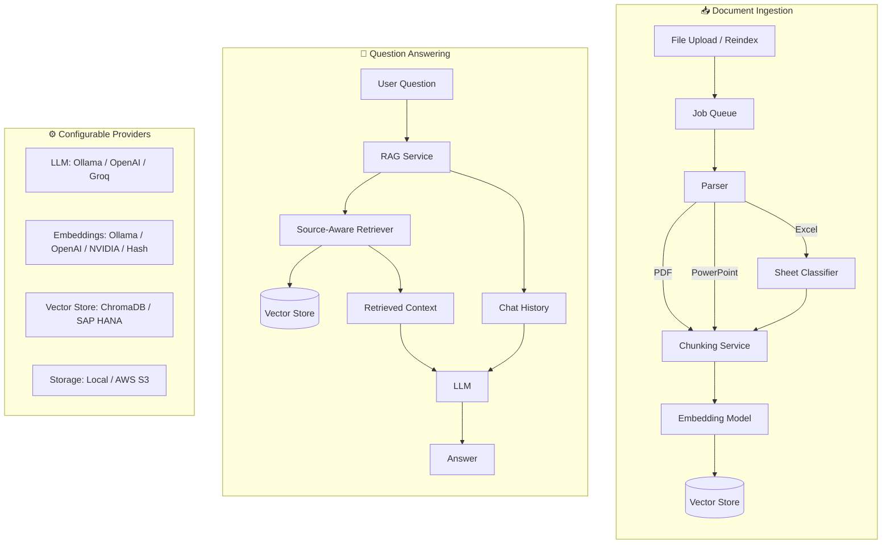

/effort

# Python RAG Learning

A FastAPI-based retrieval-augmented generation (RAG) application. Upload documents, index them into a vector store, and ask questions about their contents using an LLM.

## Features

- **Multi-format parsing** — Excel (.xlsx/.xls/.xlsm), PDF, PowerPoint (.pptx/.pptm); PDF and PowerPoint go through [Docling](https://github.com/docling-project/docling) (tables as Markdown, OCR for scans; models download on first conversion — see [CONFIGURATION.md](CONFIGURATION.md#document-parsing))
- **Semantic chunking** — LLM-powered document splitting by meaning (with rule-based fallback)
- **Excel classification** — Automatically detects structured vs. unstructured spreadsheets
- **Async processing** — Background job queue for uploads and reindexing
- **Flexible LLM backends** — Ollama (local), OpenAI, or Groq
- **Flexible embeddings** — Ollama, OpenAI, NVIDIA, or deterministic hash
- **Multiple vector stores** — ChromaDB (local/HTTP) or SAP HANA Cloud
- **Multiple storage backends** — Local filesystem or AWS S3
- **Session-based chat** — Follow-up questions use conversation history
- **Source-aware retrieval** — Retrieves relevant context across all indexed files
- **Hybrid search** — BM25 lexical ranking fused with vector similarity (reciprocal rank fusion), so exact identifiers and rare terms are not lost to embeddings
- **Agentic chat** — The LLM decides which tools to call (search the knowledge base, or query Jira read-only via an MCP server) instead of a fixed retrieve-then-answer flow, with automatic fallback to the classic RAG chain
- **Streaming (SSE)** — `POST /ai/chat/stream` streams replies token-by-token as Server-Sent Events (`tool`, `token`, `done`, `error`)

## System Architecture



## Quick Start

### Prerequisites

- Python 3.9+
- [Ollama](https://ollama.com/) (for local mode — pull models below)

```bash
ollama pull gemma4
ollama pull nomic-embed-text
```

### Install & Run

```bash
# Clone and enter the project
git clone <repo-url> && cd python-rag-learning

# Install dependencies
pip install -r requirements.txt

# Configure (edit .env with your settings)
cp .env.example .env        # macOS/Linux
copy .env.example .env      # Windows

# Start the server
uvicorn main:app --reload
```

**Create & activate the virtual environment**

macOS/Linux:

```bash
python3 -m venv venv
source venv/bin/activate
```

Windows (PowerShell):

```powershell
python -m venv venv
venv\Scripts\activate
```

The API is available at **http://127.0.0.1:8000**. Interactive docs at [`/docs`](http://127.0.0.1:8000/docs).

On first startup, the app indexes all files in storage. If the vector store already has data, it skips reindexing.

### CLI Mode

macOS/Linux:

```bash
python3 main.py
```

Windows (PowerShell):

```powershell
python main.py
```

Type `q` to quit the interactive chat loop.

## API Reference

All routes are prefixed with `/ai`.

| Method     | Endpoint              | Description                             | Response                    |
| ---------- | --------------------- | --------------------------------------- | --------------------------- |
| `POST`   | `/ai/chat`          | Ask a question about indexed documents  | 200 — answer               |
| `POST`   | `/ai/chat/stream`   | Ask a question, stream the reply as SSE | 200 —`text/event-stream` |
| `GET`    | `/ai/agent-status`  | Inspect agent / Jira MCP load state     | 200 — agent status         |
| `POST`   | `/ai/upload`        | Upload a file (async indexing)          | 202 — job accepted         |
| `GET`    | `/ai/files`         | List files in storage                   | 200 — file list            |
| `DELETE` | `/ai/files`         | Delete one or more files                | 200 — deletion result      |
| `POST`   | `/ai/reindex`       | Rebuild the entire vector store         | 202 — job accepted         |
| `GET`    | `/ai/jobs`          | List all background jobs                | 200 — job list             |
| `GET`    | `/ai/jobs/{job_id}` | Get status of a specific job            | 200 — job status           |

### Usage Examples

**Upload a file** (returns immediately with a job ID):

```bash
curl -X POST http://127.0.0.1:8000/ai/upload \
  -F "file=@report.pdf"
```

```json
{"job_id": "abc-123", "filename": "report.pdf", "path": "data/report.pdf", "status": "queued"}
```

**Poll job status:**

```bash
curl http://127.0.0.1:8000/ai/jobs/abc-123
```

```json
{"job_id": "abc-123", "status": "complete", "type": "index", "filename": "report.pdf", "indexed_records": 42, "created_at": "...", "completed_at": "..."}
```

**Ask a question:**

```bash
curl -X POST http://127.0.0.1:8000/ai/chat \
  -H "Content-Type: application/json" \
  -d '{"question": "What internships are available?"}'
```

```json
{"session_id": "uuid-here", "question": "What internships are available?", "answer": "Based on the documents...", "tools_used": ["search_knowledge_base"]}
```

**Ask a question (streaming SSE):**

`-N` disables curl's buffering so events arrive as they are produced.

```bash
curl -N -X POST http://127.0.0.1:8000/ai/chat/stream \
  -H "Content-Type: application/json" \
  -d '{"question": "What internships are available?"}'
```

```
event: tool
data: {"name": "search_knowledge_base"}

event: token
data: {"text": "Based on "}

event: token
data: {"text": "the documents..."}

event: done
data: {"session_id": "uuid-here", "answer": "Based on the documents...", "tools_used": ["search_knowledge_base"]}
```

**Check agent / Jira status:**

```bash
curl http://127.0.0.1:8000/ai/agent-status
```

```json
{"agent_enabled": true, "agent_ready": true, "jira_enabled": false, "jira_loaded": false, "tool_count": 2, "tools": ["search_knowledge_base", "list_knowledge_base_sources"], "jira_error": null}
```

**List files:**

```bash
curl http://127.0.0.1:8000/ai/files
```

**Delete files:**

```bash
curl -X DELETE http://127.0.0.1:8000/ai/files \
  -H "Content-Type: application/json" \
  -d '{"filenames": ["report.pdf", "old-data.xlsx"]}'
```

**Reindex all files:**

```bash
curl -X POST http://127.0.0.1:8000/ai/reindex
```

## Project Structure

```
python-rag-learning/
├── api/routes/
│   ├── chat.py              # Question-answering endpoint
│   ├── delete.py            # File deletion endpoint
│   ├── files.py             # File listing endpoint
│   ├── jobs.py              # Background job status endpoints
│   └── upload.py            # Upload and reindex endpoints
├── core/
│   └── config.py            # Environment-based settings
├── models/
│   └── schemas.py           # Pydantic request/response models
├── services/
│   ├── agent_service.py     # Agentic chat: tool-calling agent, MCP/Jira, streaming
│   ├── chunking_service.py  # Semantic + rule-based document chunking
│   ├── classifier_service.py # Excel sheet structure classification
│   ├── document_service.py  # PDF/PowerPoint parsing (Docling)
│   ├── embed_service.py     # Vector store management and retrieval
│   ├── excel_service.py     # Excel file parsing
│   ├── file_service.py      # File storage helpers
│   ├── hash_embedding_service.py # Deterministic hash embeddings
│   ├── job_queue.py         # Background job processing
│   ├── rag_service.py       # LLM chain and chat sessions
│   ├── storage_service.py   # Local and S3 storage backends
│   └── vectorstore_service.py # ChromaDB and HANA backends
├── aws/                     # Example IAM and bucket policies
├── data/                    # Local file storage (default)
├── scripts/                 # Utility scripts (S3 smoke test)
├── tests/                   # Unit tests
├── main.py                  # FastAPI app entry point
├── requirements.txt
├── CONFIGURATION.md         # Full environment variable reference
└── .env.example             # Template configuration
```

## Configuration

The app is configured via environment variables in `.env`. The key mode switches are:

| Setting                  | Options                             | Controls                                              |
| ------------------------ | ----------------------------------- | ----------------------------------------------------- |
| `LLM_MODE`             | `local` / `hosted`              | Which LLM answers questions                           |
| `EMBEDDING_MODE`       | `local` / `custom` / `hosted` | How text becomes vectors                              |
| `CHUNKING_MODE`        | `local` / `hosted`              | How documents are split                               |
| `FILE_STORAGE_BACKEND` | `local` / `s3`                  | Where files are stored                                |
| `VECTOR_DB_BACKEND`    | `chroma` / `hana`               | Where vectors are stored                              |
| `AGENT_ENABLED`        | `true` / `false`                | Agentic tool-calling chat (falls back to classic RAG) |
| `JIRA_ENABLED`         | `true` / `false`                | Expose read-only Jira tools via MCP                   |

See **[CONFIGURATION.md](CONFIGURATION.md)** for the complete variable reference with defaults and examples. Enabling agentic chat and Jira is documented in the [Jira (via MCP)](CONFIGURATION.md#jira-via-mcp) section — note it needs a tool-calling LLM and `pip install langchain-mcp-adapters mcp-atlassian`.

## Testing

macOS/Linux:

```bash
source venv/bin/activate
python -m unittest discover -s tests
```

Windows (PowerShell):

```powershell
venv\Scripts\activate
python -m unittest discover -s tests
```

Tests use fake clients and do not require external services or AWS credentials.

### S3 Smoke Test

Verifies that your AWS credentials can upload/download/delete from the configured bucket:

macOS/Linux:

```bash
venv/bin/python scripts/s3_upload_smoke_test.py
```

Windows (PowerShell):

```powershell
venv\Scripts\python scripts/s3_upload_smoke_test.py
```

## Storage Backends

| Backend          | Config                         | Notes                                                          |
| ---------------- | ------------------------------ | -------------------------------------------------------------- |
| **Local**  | `FILE_STORAGE_BACKEND=local` | Files in`data/` directory                                    |
| **AWS S3** | `FILE_STORAGE_BACKEND=s3`    | Syncs to local cache for parsing. Example policies in`aws/`. |

## Vector Store Backends

| Backend                  | Config                     | Notes                                                                   |
| ------------------------ | -------------------------- | ----------------------------------------------------------------------- |
| **ChromaDB local** | `CHROMA_MODE=local`      | Persists to`chrome_langchain_db/`. No external services needed.       |
| **ChromaDB HTTP**  | `CHROMA_MODE=http`       | Connects to a remote Chroma server. Set`CHROMA_HOST`/`CHROMA_PORT`. |
| **SAP HANA Cloud** | `VECTOR_DB_BACKEND=hana` | Requires`hdbcli` and `langchain-hana`. Set `HANA_DB_*` vars.      |

## License

MIT
